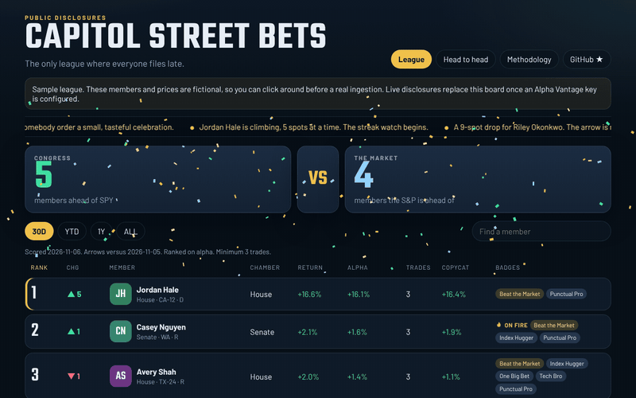

# Capitol Gains

The only league where everyone files late.

### 🏛 [**Open the live scoreboard →**](https://bernhardbrugger.github.io/capitol-street-bets/)

## Current standings

<!-- LEADERBOARD:START -->
> ⚠️ **Sample data.** These names and numbers are fictional. The board switches to live disclosures after the first successful data refresh.

**Top 10, last 12 months** (as of 2026-11-06)

| # | | Member | Seat | Return | Alpha vs S&P | Copycat | Trades |
|---:|:---:|---|---|---:|---:|---:|---:|
| 1 | ▲5 | [Jordan Hale](https://bernhardbrugger.github.io/capitol-street-bets/#/member/CG0001) | D-CA · H | +16.6% | **+16.1%** | +16.4% | 3 |
| 2 | ▲1 | [Casey Nguyen](https://bernhardbrugger.github.io/capitol-street-bets/#/member/CG0002) | R-WA · S | +2.1% | **+1.6%** | +1.9% | 3 |
| 3 | ▼1 | [Avery Shah](https://bernhardbrugger.github.io/capitol-street-bets/#/member/CG0005) | R-TX · H | +2.0% | **+1.4%** | +1.1% | 3 |
| 4 | ▬ | [Reese Dalton](https://bernhardbrugger.github.io/capitol-street-bets/#/member/CG0010) | D-WA · H | +0.9% | **+0.4%** | +0.6% | 3 |
| 5 | ▬ | [Parker Singh](https://bernhardbrugger.github.io/capitol-street-bets/#/member/CG0007) | R-OH · S | +0.3% | **+0.2%** | +0.1% | 10 |
| 6 | ▲1 | [Morgan Ellis](https://bernhardbrugger.github.io/capitol-street-bets/#/member/CG0004) | I-ME · S | +0.5% | **+0.0%** | +0.4% | 4 |
| 7 | ▲1 | [Skyler Brooks](https://bernhardbrugger.github.io/capitol-street-bets/#/member/CG0009) | D-HI · S | +0.3% | **-0.4%** | +0.2% | 3 |
| 8 | ▲1 | [Rowan Blake](https://bernhardbrugger.github.io/capitol-street-bets/#/member/CG0013) | R-MI · H | -0.4% | **-0.9%** | -0.3% | 3 |
| 9 | ▲1 | [Jamie Ortiz](https://bernhardbrugger.github.io/capitol-street-bets/#/member/CG0011) | R-AZ · H | -2.1% | **-2.8%** | -1.4% | 6 |
| 10 | ▲1 | [Drew Coleman](https://bernhardbrugger.github.io/capitol-street-bets/#/member/CG0008) | R-FL · H | -1.9% | **-4.1%** | -0.2% | 3 |

Updated 2026-11-06. [Full board →](https://bernhardbrugger.github.io/capitol-street-bets/)
<!-- LEADERBOARD:END -->

A scoreboard of how members of Congress do with their **publicly disclosed** stock trades: rank arrows, badges, a daily ticker tape, and a head-to-head for anyone deciding who they would rather copy. The tone stays on the numbers. Party is a label on the card, not a punchline.



The repo ships with a **fictional sample league** so the site works before any API key is set. Those names and prices are made up. A real ingestion replaces `web/public/data`.

## What you are looking at

- **Their returns** mark a position from the transaction date.
- **Copycat returns** start on the disclosure date, which is the first day someone outside the filing could have known.
- **Alpha vs S&P** uses SPY over those exact same dates.
- Position size is the **midpoint** of the disclosed dollar range.

The long version is [METHODOLOGY.md](METHODOLOGY.md), and the same note is linked from the site.

**For entertainment. Based on public disclosures via Alpha Vantage. Amounts are estimated from disclosed ranges. Not financial advice.**

**Data: Alpha Vantage.**

Live site: **https://bernhardbrugger.github.io/capitol-street-bets/**

## How it is built

A Python job talks to Alpha Vantage, keeps a SQLite cache, and writes static JSON. The site is a Vite app with no runtime server: it only reads those files. That keeps GitHub Pages enough.

Vite, rather than a server framework, because the page is a scoreboard over one JSON blob. Hash routes cover the member card and the head-to-head. There is nothing to host but the files.

## Run it locally

```bash
python -m pytest
cd web && npm install && npm run dev
```

The dev server prints a local URL. The sample board is already in `web/public/data`.

Regenerate that sample:

```bash
PYTHONPATH=src python -m capitol_gains sample
```

## Use a real Alpha Vantage key

```bash
cp .env.example .env
# set ALPHAVANTAGE_API_KEY
PYTHONPATH=src python -m capitol_gains run
```

The key is read from the environment and is not written into the repo, the logs, or the JSON.

`docs/av-fields.md` lists the response fields this job actually saw, including the fact that the demo trade payload has no `source_url`. When a row does include one, it is kept and linked. Otherwise the member card points at the House Clerk or Senate EFD search.

### Rate limits and the rotation

Checked against Alpha Vantage's current plan page and the demo metadata call:

| Plan | Requests | Daily cap |
| --- | --- | --- |
| Free | 25 per day. Throttle notes also cite 5 per minute. | 25 |
| Premium | 75, 150, 300, 600, or 1200 per minute | none |

Defaults in `.env.example` match the free plan: `AV_REQUESTS_PER_MINUTE=5`, `AV_REQUESTS_PER_DAY=25`. Set `AV_REQUESTS_PER_DAY=0` and your plan's per-minute number for premium. If a response states a frequency ("5 calls per minute and 25 calls per day"), those numbers are stored and used from then on.

The demo roster on 2026-11-06 had **1,146** people, **537** of them seated (439 House, 98 Senate). A full daily pass is one metadata call, one trade call per member, and one price call per ticker that does not already have the latest weekday. Price history is never re-downloaded while that bar is cached. Member payloads with an unchanged hash are not rewritten. A run that hits the daily cap stops cleanly and continues next time with whoever is stalest.

On a 25-request day the split is about **1** metadata call (when the roster is older than 7 days), **8** price calls, and **16** member calls. At that pace:

- Seated members each get a turn about every **34** daily runs (537 / 16), roughly five weeks for a full seated pass, then the stalest ones start again. Weekend runs spend nothing on prices, so they go almost entirely to members.
- A planning guess of **1,500** distinct tickers (not measured until a real ingest) would take about **190** trading days to touch once at 8 prices a day. The free plan cannot keep a full book marked to the latest close. Windows are limited to the sessions actually cached. `outputsize=compact` starts with about 100 sessions and then grows by the new days you merge in. `outputsize=full` and `TIME_SERIES_DAILY_ADJUSTED` are premium. Raw closes are not split-adjusted.

On the cheapest premium plan (75/minute, no daily cap) a seated pass plus 1,500 tickers is about **2,040** requests, roughly **half an hour**. Set:

```bash
AV_REQUESTS_PER_MINUTE=75
AV_REQUESTS_PER_DAY=0
AV_PRICE_FUNCTION=TIME_SERIES_DAILY_ADJUSTED
AV_OUTPUTSIZE=full
```

If adjusted prices are rejected, the job switches to `TIME_SERIES_DAILY` and records that.

## Tests

```bash
python -m pytest
cd web && npx playwright install chromium && npm run test:e2e
```

Unit tests cover FIFO returns, the SPY comparison, rank arrows, streaks, every ticker-tape template, a banned-word scan, and a mocked ingestion that hits a rate limit, resumes the next day, and does not re-download a fresh price.

## Docker

```bash
docker compose up --build
```

The scoreboard is on port **8088**. To refresh from Alpha Vantage into `web/public/data`:

```bash
docker compose --profile refresh run --rm refresh
```

## GitHub Actions

- `.github/workflows/test.yml` runs pytest and Playwright on push.
- `.github/workflows/daily.yml` does the refresh and the deploy:
  - **Once a day** (05:17 UTC) or on a manual *Run workflow*, it restores the SQLite cache, ingests what the Alpha Vantage plan allows with the `ALPHAVANTAGE_API_KEY` repository secret, scores, writes the top 10 into the *Current standings* block of this README, commits any change and deploys `web/dist` to GitHub Pages.
  - On a **push to `main`** that touches `web/`, `src/` or the workflow, it only rebuilds and redeploys the site from the JSON already in the repo. No API calls.

The API key lives only in the repository secret. It is never printed, never written to the cache, the JSON, the README or the built site, and the browser never talks to Alpha Vantage: the page only reads static JSON.

Pages setup (already done for this repo): Settings → Pages → Source: **GitHub Actions**. The base path is taken from the repo name, so a rename or fork just works.

Until the secret exists, the daily job leaves the sample JSON in place and still deploys the site.

Regenerate the standings block locally:

```bash
PYTHONPATH=src python -m capitol_gains readme
```
